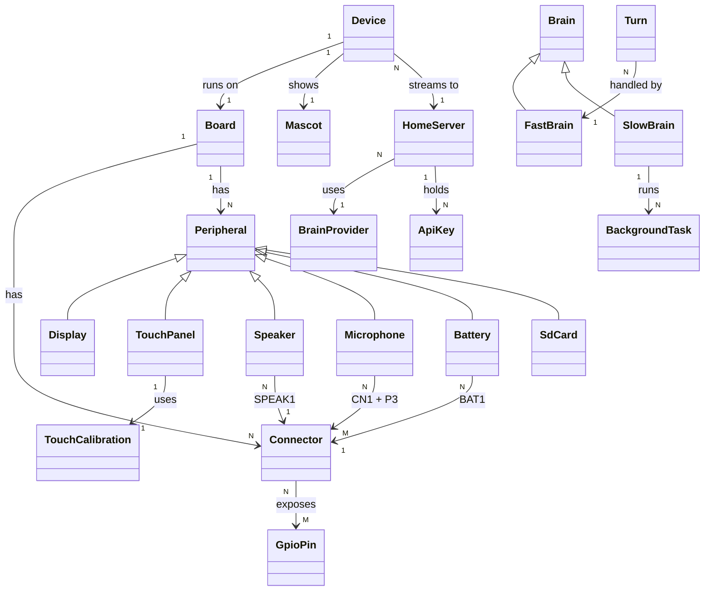
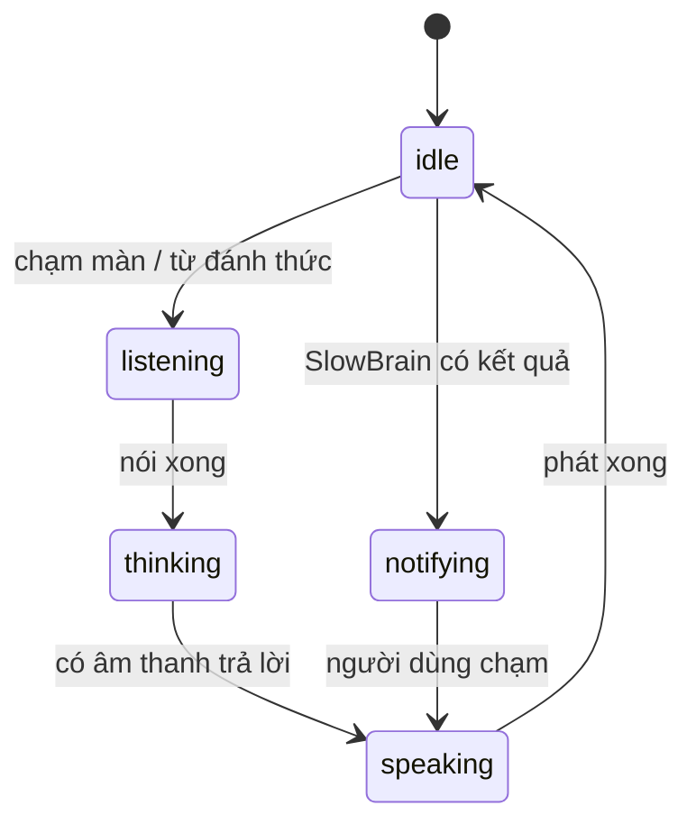
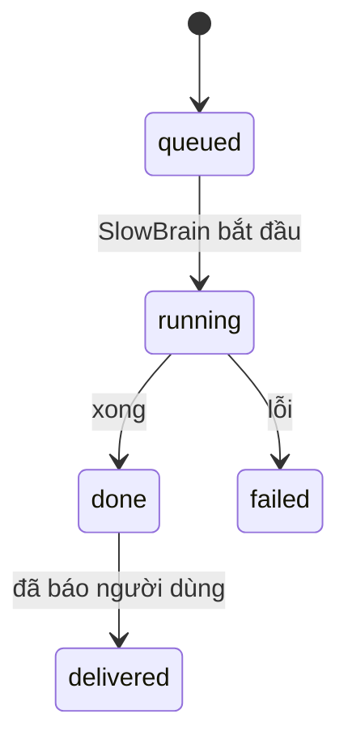

# Ontology: byteofesp32

## 1. Phạm vi
- Ngày: 2026-11-16, commit `d8f55bf` (firmware đầu tiên). Màn, cảm ứng và hiệu chỉnh đã neo vào `firmware/`; phần trợ lý (Device, HomeServer, Brain) vẫn neo vào tài liệu thiết kế và ADR.
- Hai vùng: `hardware` (board và linh kiện), `system` (trợ lý: Device, HomeServer, Brain).
- Kiểm tra lại (Git Bash, từ gốc repo):
  ```
  python -I ~/.claude/skills/ontology/scripts/check_ontology.py .claude/ontology/ontology.json --md .claude/ontology/ontology.md --resolve
  ```
- Khi có code firmware/server: chuyển neo từ tài liệu sang file code định nghĩa khái niệm.

## 2. Sơ đồ tổng quan


## 3. Thuật ngữ
| Khái niệm | Loại | Định nghĩa | Tên khác | Định nghĩa ở |
|---|---|---|---|---|
| Board | entity | Bo mạch ESP32 classic màn 3.5", không PSRAM; không phải CYD 2.8" | ESP32-3248S035R, ESP32-035, "con mạch" | [esp32-3248s035r.md:1](docs/hardware/esp32-3248s035r.md#L1) |
| Connector | entity | Cổng vật lý, nhận ra bằng chữ in | cổng, JST 1.25 | [esp32-3248s035r.md:31](docs/hardware/esp32-3248s035r.md#L31) |
| GpioPin | value | Chân tín hiệu ESP32; trống: 21, 22, 35 | IO21, GPIO27 | [esp32-3248s035r.md:16](docs/hardware/esp32-3248s035r.md#L16) |
| Peripheral | concept | Thiết bị gắn vào board, firmware điều khiển qua GPIO | linh kiện, module | [esp32-3248s035r.md:9](docs/hardware/esp32-3248s035r.md#L9) |
| Display | entity | Màn ST7796 480x320, đèn nền GPIO27 | LCD, màn | [esp32-3248s035r.md:11](docs/hardware/esp32-3248s035r.md#L11) |
| TouchPanel | entity | Cảm ứng điện trở XPT2046 | touch | [esp32-3248s035r.md:12](docs/hardware/esp32-3248s035r.md#L12) |
| Speaker | entity | Loa 8Ω 1–2W ở SPEAK1, tín hiệu DAC GPIO26 | loa | [esp32-3248s035r.md:24](docs/hardware/esp32-3248s035r.md#L24) |
| Microphone | entity | Mic I2S INMP441 qua CN1 và P3 (chưa mua) | mic | [esp32-3248s035r.md:48](docs/hardware/esp32-3248s035r.md#L48) |
| Battery | entity | LiPo 3.7V 1 cell có mạch bảo vệ ở BAT1 (chưa mua) | pin | [esp32-3248s035r.md:62](docs/hardware/esp32-3248s035r.md#L62) |
| TouchCalibration | value | Ánh xạ giá trị thô XPT2046 sang tọa độ màn, lưu NVS, làm lại bằng nút CAN CHINH; sai số đo được 4–5px | cal, cal_lgfx | [touch.cpp:25](firmware/src/touch.cpp#L25) |
| SdCard | entity | Thẻ microSD ở TF1; lưu âm thanh, hình, log | thẻ nhớ, TF | [esp32-3248s035r.md:23](docs/hardware/esp32-3248s035r.md#L23) |
| Device | entity | Firmware trên Board: linh vật, chạm, mic, loa; không giữ key | firmware, thin client | [assistant.md:6](docs/design/assistant.md#L6) |
| HomeServer | entity | Chương trình Python trong mạng nhà làm phần nặng | server, relay | [assistant.md:7](docs/design/assistant.md#L7) |
| Brain | concept | Model ngôn ngữ, chỉ nhận/trả chữ | LLM, "đầu não" | [assistant.md:8](docs/design/assistant.md#L8) |
| BrainProvider | config | Chọn nhà cung cấp model (Muse hoặc Claude) bằng cấu hình | provider | [0002-swappable-brain.md:10](docs/decisions/0002-swappable-brain.md#L10) |
| FastBrain | process | Trả lời ngay trong một Turn | não nhanh | [assistant.md:9](docs/design/assistant.md#L9) |
| SlowBrain | process | Việc chạy nền, báo kết quả sau | não chậm | [assistant.md:10](docs/design/assistant.md#L10) |
| Turn | event | Một lần hỏi và trả lời | lượt | [assistant.md:12](docs/design/assistant.md#L12) |
| Mascot | entity | Mặt trên màn: hai mắt robot con ngươi khe dọc, tai cáo, mũi, miệng ω | linh vật, mặt cáo | [mascot.hpp:30](firmware/src/mascot.hpp#L30), [spec](docs/design/mascot/spec.md) |
| BackgroundTask | entity | Việc SlowBrain nhận và báo kết quả | job | [assistant.md:23](docs/design/assistant.md#L23) |
| WakeWordDetection | process | Server nghe từ đánh thức trong luồng âm thanh | openWakeWord | [0003-wake-word-on-server.md:10](docs/decisions/0003-wake-word-on-server.md#L10) |
| SpeechToText | process | Đổi giọng nói thành chữ | STT, faster-whisper | [assistant.md:15](docs/design/assistant.md#L15) |
| TextToSpeech | process | Đổi câu trả lời thành âm thanh | TTS, Piper | [assistant.md:15](docs/design/assistant.md#L15) |
| ApiKey | concept | Bí mật gọi BrainProvider, chỉ ở server | key | [0001-thin-client-home-server.md:13](docs/decisions/0001-thin-client-home-server.md#L13) |

## 4. Quan hệ
| Quan hệ | Từ → Đến | Bản số | Thể hiện ở |
|---|---|---|---|
| board_has_connector | Board → Connector | 1:N | Bảng cổng |
| connector_exposes_gpio | Connector → GpioPin | N:M | IO21/IO22 có ở cả CN1 và P3 |
| board_has_peripheral | Board → Peripheral | 1:N | Mục thông số |
| microphone_wired_to_connector | Microphone → Connector | N:M | Bảng đi dây mic |
| speaker_plugs_into | Speaker → Connector | N:1 | SPEAK1 |
| battery_plugs_into | Battery → Connector | N:1 | BAT1 |
| device_runs_on_board | Device → Board | 1:1 | Thiết kế trợ lý |
| device_streams_to_server | Device → HomeServer | N:1 | WebSocket trong mạng nhà |
| device_shows_mascot | Device → Mascot | 1:1 | Thiết kế trợ lý |
| server_uses_provider | HomeServer → BrainProvider | N:1 | Cấu hình `brain` |
| server_holds_apikey | HomeServer → ApiKey | 1:N | `server/.env` |
| turn_handled_by_fastbrain | Turn → FastBrain | N:1 | Bước 3 của một lượt |
| slowbrain_runs_task | SlowBrain → BackgroundTask | 1:N | Việc chạy nền |
| touchpanel_uses_calibration | TouchPanel → TouchCalibration | 1:1 | `rawToScreen()` trong `firmware/src/touch.cpp` |

## 5. Vòng đời
Mascot.state ([assistant.md:20](docs/design/assistant.md#L20)):


BackgroundTask.status ([assistant.md:24](docs/design/assistant.md#L24)):


Giá trị khác (enum): `BrainProviderName` = muse, claude; `ActivationMethod` = touch, wake_word; `Expression` = neutral, happy, laugh, excited, love, shy, smug, sad, cry, angry, surprised, scared, confused, bored, sleepy ([mascot.hpp:12](firmware/src/mascot.hpp#L12)).

## 6. Quy tắc
| ID | Quy tắc | Ghi ở | Test |
|---|---|---|---|
| R1 | Dùng cấu hình 3.5" (ST7796, đèn nền GPIO27); cấu hình 2.8" làm màn đen | [AGENTS.md:44](AGENTS.md#L44), `firmware/platformio.ini` | Chưa có (người dùng xác nhận màu bằng mắt) |
| R2 | API key chỉ trên HomeServer, không trên Device | [0001:13](docs/decisions/0001-thin-client-home-server.md#L13) | Chưa có |
| R3 | Mic dùng IO21/IO22/IO35; gắn mic thì CN1 hết dùng cho I2C | [esp32-3248s035r.md:58](docs/hardware/esp32-3248s035r.md#L58) | Chưa có |
| R4 | Pin LiPo 1 cell có bảo vệ; dây đỏ vào BAT+ | [esp32-3248s035r.md:36](docs/hardware/esp32-3248s035r.md#L36) | Chưa có |
| R5 | Sao lưu flash gốc trước lần nạp đầu tiên | [AGENTS.md:46](AGENTS.md#L46) | Chưa có |
| R6 | Không chạy từ đánh thức trên chip; Device stream âm thanh | [esp32-3248s035r.md:66](docs/hardware/esp32-3248s035r.md#L66) | Chưa có |
| R7 | Server gọi model bằng API key, không bằng đăng nhập claude.ai | [0002:11](docs/decisions/0002-swappable-brain.md#L11) | Chưa có |
| R8 | Thông tin tài khoản chỉ ở docs/private | [AGENTS.md:48](AGENTS.md#L48) | Chưa có |
| R9 | Màn dùng TFT_eSPI; cảm ứng chỉ coi là chạm khi PENIRQ (GPIO36) thấp, không dùng `getTouch()` của TFT_eSPI | [touch.cpp:122](firmware/src/touch.cpp#L122), [AGENTS.md:45](AGENTS.md#L45) | `touch::verify()` in `[touchtest] worst=` (bán tự động, cần người chạm) |

## 7. Phát hiện
- Tên gọi trôi: người bán gọi board là "2.8 inch"; nghiên cứu ban đầu dùng "CYD ESP32-2432S028R"; đúng là ESP32-3248S035R. Mọi tài liệu mới dùng tên đúng.
- Người dùng gọi Brain là "đầu não"; trong code dùng `Brain` / `BrainProvider`.
- R1 và R9 đã có code thực thi và kiểm tra bán tự động (cần người nhìn/chạm). R2–R8 vẫn chỉ nằm trong tài liệu vì chưa có server.
- Tên trôi: firmware gốc của nhà sản xuất gọi board là "3.5inch_ESP32-2432S035" (lẫn số 2432 của bản 2.8").
- Phần nguồn (chip sạc, SW1, chân đo pin) chưa có tài liệu xác nhận: xem `docs/open-questions.md` Q1–Q4.

## 8. Ánh xạ ngoài
Không có.
